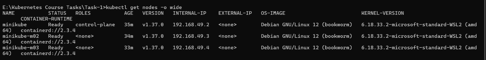
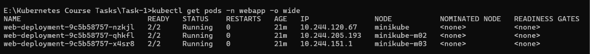
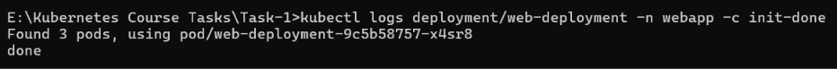
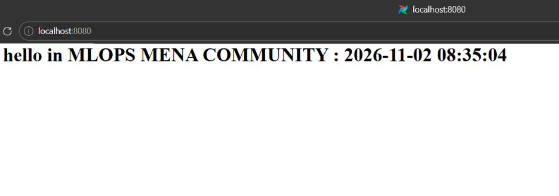
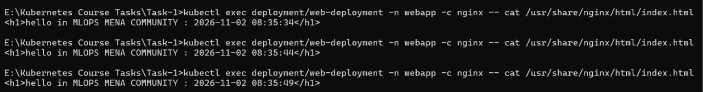
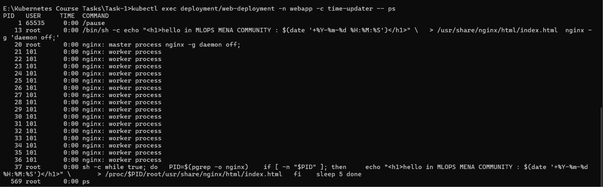
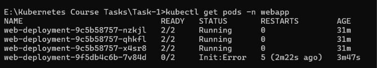
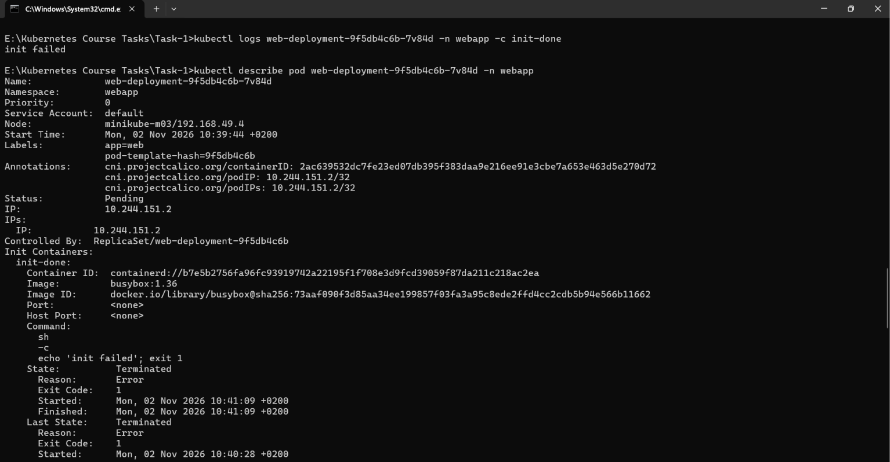
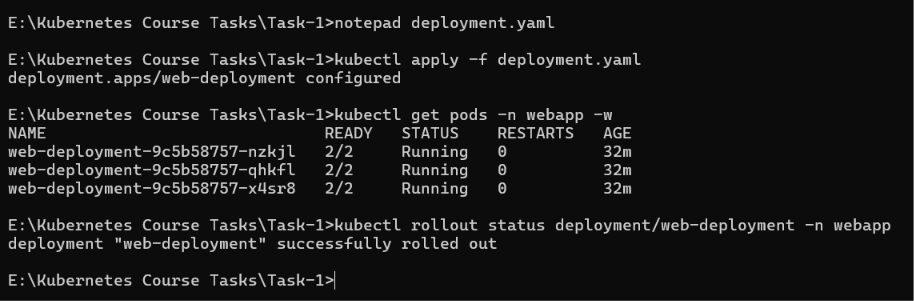

# Task Session 1: Multi-Container Pods (Init Container & Sidecar)

## 1. Overview

This task demonstrates Kubernetes multi-container Pods using an Init Container, a Main Container, and a Sidecar Container.

The objective is to deploy an Nginx web application on a **3-node Minikube cluster**. The application displays the current timestamp and automatically updates it every 5 seconds without restarting Nginx.

## 2. Kubernetes Environment

| Component | Configuration |
|---|---|
| Kubernetes | v1.37.0 |
| Cluster | Minikube |
| Nodes | 1 Control Plane + 2 Workers |
| CNI | Calico |
| Container Runtime | containerd |
| Namespace | webapp |
| Deployment | web-deployment |
| Replicas | 3 |

## 3. Pod Architecture

Each Pod runs three containers:

### Init Container: `init-done`

- Image: `busybox:1.36`
- Executes `echo done`.
- Exits successfully with exit code 0.
- Ensures initialization completes before application containers start.

### Main Container: `nginx`

- Image: `nginx:1.27`
- Listens on port 80.
- Creates the initial `index.html` with the current timestamp.
- Runs Nginx in foreground mode.

### Sidecar Container: `time-updater`

- Image: `busybox:1.36`
- Updates the Nginx HTML page every 5 seconds.
- Uses `pgrep` to identify the Nginx process.
- Accesses the Nginx filesystem through `/proc/<pid>/root`.
- Uses the `SYS_PTRACE` Linux capability.

### Shared Process Namespace

The Pod uses:

```yaml
shareProcessNamespace: true
```

This allows containers within the same Pod to see each other's processes.

**Important:** No application volumes are configured. The HTML file is updated through the shared process namespace and `/proc`.

## 4. Deployment

The Kubernetes manifest is available in `deployment.yaml`.

Create the namespace:

```bash
kubectl create namespace webapp
```

Apply the configuration:

```bash
kubectl apply -f deployment.yaml
```

Verify the Deployment:

```bash
kubectl get deployments -n webapp
```

Verify the Pods:

```bash
kubectl get pods -n webapp -o wide
```

Expected result: Three Pods, each with two running application containers (`2/2 Running`).

## 5. Application Access

Expose the application locally using port forwarding:

```bash
kubectl port-forward -n webapp deploy/web-deployment 8080:80
```

Open the application:

[http://localhost:8080](http://localhost:8080)

The webpage displays:

```text
hello in MLOPS MENA COMMUNITY : <TIMESTAMP>
```

The timestamp automatically changes every 5 seconds.

## 6. Verification

The following commands were used to verify the implementation.

### Check Cluster Nodes

```bash
kubectl get nodes -o wide
```

### Check Init Container Logs

```bash
kubectl logs deployment/web-deployment -n webapp -c init-done
```

Expected output:

```text
done
```

### Check the Sidecar Processes

```bash
kubectl exec deployment/web-deployment -n webapp -c time-updater -- ps
```

This verifies that the Sidecar can see Nginx processes through the shared process namespace.

### Verify Timestamp Updates

```bash
kubectl exec deployment/web-deployment -n webapp -c nginx -- cat /usr/share/nginx/html/index.html
```

Running this command multiple times confirms that the timestamp changes.

### Verify No Application Volumes

```bash
kubectl get deployment web-deployment -n webapp -o jsonpath='{.spec.template.spec.volumes}'
```

## 7. Init Container Failure Experiment

To investigate Kubernetes behavior when an Init Container fails, the initialization command was intentionally modified:

```bash
echo 'init failed'; exit 1
```

After applying the modified configuration:

```bash
kubectl apply -f deployment.yaml
```

The new Pod entered:

```text
Init:Error
Init:CrashLoopBackOff
```

### Failure Diagnosis

The failure was investigated using:

```bash
kubectl get pods -n webapp
```

```bash
kubectl logs POD_NAME -n webapp -c init-done
```

```bash
kubectl describe pod POD_NAME -n webapp
```

The Init Container terminated with exit code 1.

### Observations

1. The new Pod could not complete initialization.
2. Nginx and time-updater did not start in the failed Pod.
3. The previous healthy Pods remained running during the failed rollout.
4. The existing application remained accessible through the old Pods.

This experiment demonstrates Init Container execution requirements and Deployment rolling update behavior.

## 8. Recovery

The original initialization command was restored:

```bash
echo done
```

The corrected configuration was applied:

```bash
kubectl apply -f deployment.yaml
```

The rollout was verified:

```bash
kubectl rollout status deployment/web-deployment -n webapp
```

Expected output:

```text
deployment "web-deployment" successfully rolled out
```

Final verification:

```bash
kubectl get deployments -n webapp
kubectl get pods -n webapp
```

All three Pods returned to `2/2 Running`, and the Deployment successfully recovered.

## 9. Screenshots & Evidence

The following screenshots document the implementation, verification, failure experiment, and recovery.

### 1. Three-Node Minikube Cluster



### 2. Running Application Pods



### 3. Successful Init Container Execution



### 4. Nginx Web Application



### 5. Automatic Timestamp Updates



### 6. Shared Process Namespace and Sidecar



### 7. Init Container Failure



### 8. Failure Diagnosis



### 9. Successful Recovery



## 10. Conclusion

Successfully implemented and tested a Kubernetes multi-container application using an Init Container, an Nginx Main Container, and a Sidecar Container.

The task demonstrates:

- Multi-container Pod architecture.
- Init Container execution and failure handling.
- Shared process namespaces.
- Container coordination.
- Linux process filesystem access.
- Automatic application updates.
- Kubernetes Deployment rolling updates and recovery.

**Result:** Successfully deployed a three-replica Nginx application across a 3-node Minikube cluster, verified its functionality, tested Init Container failure behavior, and restored the application successfully.
