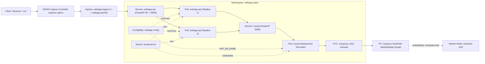

# Task Session 2: Multi-Tier FastAPI + MySQL Guestbook on Kubernetes

## 1. Project Overview

This task implements a multi-tier **Guestbook** web application on a **3-node Minikube Kubernetes cluster** (`minikube`, `minikube-m02`, `minikube-m03`). It consists of a **FastAPI** frontend/API tier (2 replicas), a **MySQL 8.4** database tier (1 replica with persistent storage), Kubernetes **ConfigMap** and **Secret** configuration, **PersistentVolume / PersistentVolumeClaim** pinned to `minikube-m02`, and external HTTP routing via the **NGINX Ingress Controller**.

All Task 2 resources are isolated in the dedicated **`webapp-stack`** namespace so the existing Task 1 workload (`web-deployment` in namespace `webapp`) remains untouched.

---

## 2. Architecture Explanation

1. **External Traffic & Ingress (`webapp-ingress`)**: Client requests arrive at the NGINX Ingress Controller (`ingress-nginx`), which evaluates `webapp-ingress` (`ingressClassName: nginx`) and routes all `/` (`Prefix`) traffic to the `webapp-api` ClusterIP Service on port `80`.
2. **Application Tier (`webapp-api`)**: A Kubernetes Deployment running **2 replicas** of the FastAPI application (`webapp-api:task2`, container port `8000`). The `webapp-api` ClusterIP Service load-balances incoming requests across both Pods.
3. **Configuration & Secrets**:
   - Non-sensitive configuration (`APP_TITLE`, `APP_ENV`, `MYSQL_HOST`, `MYSQL_PORT`, `MYSQL_DATABASE`) is injected from ConfigMap `webapp-config`.
   - Sensitive database credentials (`root-password`, `app-user`, `app-password`) are injected from Secret `mysql-secret`.
4. **Database Tier (`mysql`)**: A Kubernetes Deployment (`strategy: Recreate`, 1 replica) running `webapp-mysql:task2` (MySQL 8.4, port `3306`), exposed internally via ClusterIP Service `mysql`.
5. **Persistent Storage (`mysql-pv` & `mysql-pvc`)**: MySQL mounts `/var/lib/mysql` from `mysql-pvc` (2Gi, `storageClassName: manual`), which binds to `mysql-pv` (`hostPath: /data/webapp-mysql`). `nodeAffinity` pins `mysql-pv` to worker node **`minikube-m02`**, guaranteeing that recreated MySQL Pods always schedule on the node holding the data directory.

### Architecture Diagram



---

## 3. Project Structure

```text
Task-2/
├── .gitignore
├── README.md
├── kubernetes/
│   ├── configmap.yaml
│   ├── ingress.yaml
│   ├── namespace.yaml
│   ├── secret.example.yaml
│   └── secret.yaml               # Local-only (gitignored, never committed)
├── mysql/
│   ├── Dockerfile
│   ├── conf/
│   │   └── mysql.cnf
│   ├── deployment.yaml
│   ├── initdb/
│   │   └── 01-setup.sh
│   ├── pv.yaml
│   ├── pvc.yaml
│   ├── schema/
│   │   └── schema.sql
│   └── service.yaml
├── screenshots/
└── webapp/
    ├── .dockerignore
    ├── Dockerfile
    ├── app/
    │   ├── __init__.py
    │   ├── main.py
    │   └── static/
    │       ├── index.html
    │       └── style.css
    ├── deployment.yaml
    ├── requirements.txt
    └── service.yaml
```

---

## 4. Technologies Used

| Component | Technology / Version |
|---|---|
| Cluster | Minikube (Docker driver, 3 nodes: `minikube`, `minikube-m02`, `minikube-m03`) |
| Kubernetes | `v1.37.0` |
| Container Runtime | `containerd://2.3.4` |
| CNI | Calico |
| Ingress Controller | `ingress-nginx` (Minikube `ingress` addon, `controller:v1.15.1`) |
| Backend / Web | Python `3.12-slim`, FastAPI `0.115.6`, Uvicorn `0.34.0`, PyMySQL `1.1.1`, Pydantic |
| Database | MySQL `8.4` (`webapp-mysql:task2`) |

---

## 5. ConfigMap and Secret Design

### ConfigMap (`webapp-config`)

Stores non-sensitive runtime settings in `Task-2/kubernetes/configmap.yaml`:

- `APP_TITLE`: `"hello in MLOPS MENA COMMUNITY"`
- `APP_ENV`: `"dev"`
- `MYSQL_HOST`: `"mysql"` (Kubernetes Service DNS name inside `webapp-stack`)
- `MYSQL_PORT`: `"3306"` (explicitly set to override the automatic `MYSQL_PORT=tcp://<ip>:3306` Service link variable injected by Kubernetes)
- `MYSQL_DATABASE`: `"webapp"`

`webapp-api` loads all keys via `envFrom.configMapRef`, while `mysql` reads `MYSQL_DATABASE` into `APP_DB_NAME` via `configMapKeyRef`.

### Secret (`mysql-secret`)

Stores database credentials (`root-password`, `app-user`, `app-password`).

- **Security Practice**: `Task-2/.gitignore` excludes `kubernetes/secret.yaml` so real credentials are never committed to Git.
- A template `Task-2/kubernetes/secret.example.yaml` with placeholder values (`CHANGE_ME_*`) is committed instead.
- Create your local `Task-2/kubernetes/secret.yaml` from the template (or create it imperatively with `kubectl create secret generic`) before deploying.

---

## 6. PV, PVC, and Node Affinity

- **PersistentVolume (`mysql-pv`)**: Cluster-scoped `2Gi` volume with `accessModes: [ReadWriteOnce]`, `storageClassName: manual`, `persistentVolumeReclaimPolicy: Retain`, and `hostPath` `/data/webapp-mysql` (`type: DirectoryOrCreate`).
- **Node Affinity**:
  ```yaml
  nodeAffinity:
    required:
      nodeSelectorTerms:
        - matchExpressions:
            - key: kubernetes.io/hostname
              operator: In
              values:
                - minikube-m02
  ```
  Because `hostPath` storage lives on a single node's local filesystem, pinning `mysql-pv` to `minikube-m02` ensures that any Pod claiming `mysql-pvc` is always scheduled on `minikube-m02` and reconnects to the existing MySQL data directory after restarts or Pod deletions.
- **PersistentVolumeClaim (`mysql-pvc`)**: Namespaced (`webapp-stack`), explicitly binds to `mysql-pv` via `storageClassName: manual` and `volumeName: mysql-pv`.

---

## 7. Build and Deployment Instructions

### Step 1: Verify Cluster, Nodes, and Ingress Controller

```powershell
kubectl config current-context
kubectl get nodes -L kubernetes.io/hostname
minikube addons enable ingress
kubectl get pods -n ingress-nginx
kubectl get ingressclass
```

### Step 2: Build Docker Images and Load into Minikube

> **Windows Build Note**: MySQL's `docker-entrypoint.sh` *sources* `.sh` files in `/docker-entrypoint-initdb.d/` only when they are **not executable** (`-x` unset). When building from Windows NTFS, Docker `COPY` assigns `0755` (`+x`), which causes `docker-entrypoint.sh` to execute `01-setup.sh` in a subshell where `mysql_note` and `docker_process_sql` are unavailable. `Task-2/mysql/Dockerfile` includes `RUN chmod -x /docker-entrypoint-initdb.d/01-setup.sh` so the image builds and initializes identically on Windows and Linux.

```powershell
docker build -t webapp-api:task2 ./Task-2/webapp
docker build -t webapp-mysql:task2 ./Task-2/mysql

minikube image load webapp-api:task2
minikube image load webapp-mysql:task2
minikube image ls | Select-String "webapp-"
```

### Step 3: Prepare Local Secret

```powershell
Copy-Item ./Task-2/kubernetes/secret.example.yaml ./Task-2/kubernetes/secret.yaml
# Edit Task-2/kubernetes/secret.yaml with your local dev credentials (e.g., rootpass123 / webapp / webapp123)
```

### Step 4: Apply Manifests in Order

```powershell
# 1. Namespace, ConfigMap, Secret
kubectl apply -f ./Task-2/kubernetes/namespace.yaml
kubectl apply -f ./Task-2/kubernetes/configmap.yaml
kubectl apply -f ./Task-2/kubernetes/secret.yaml

# 2. PersistentVolume & PersistentVolumeClaim
kubectl apply -f ./Task-2/mysql/pv.yaml
kubectl apply -f ./Task-2/mysql/pvc.yaml
kubectl get pv mysql-pv
kubectl get pvc mysql-pvc -n webapp-stack

# 3. MySQL Deployment & Service
kubectl apply -f ./Task-2/mysql/deployment.yaml
kubectl apply -f ./Task-2/mysql/service.yaml
kubectl rollout status deployment/mysql -n webapp-stack --timeout=180s

# 4. FastAPI Deployment & Service
kubectl apply -f ./Task-2/webapp/deployment.yaml
kubectl apply -f ./Task-2/webapp/service.yaml
kubectl rollout status deployment/webapp-api -n webapp-stack --timeout=120s

# 5. Ingress
kubectl apply -f ./Task-2/kubernetes/ingress.yaml
kubectl get ingress webapp-ingress -n webapp-stack
```

### Step 5: Access the Application via Ingress

In a dedicated terminal, forward local port `8080` to the NGINX Ingress Controller Service:

```powershell
kubectl port-forward -n ingress-nginx svc/ingress-nginx-controller 8080:80
```

Then open [http://localhost:8080](http://localhost:8080) in your browser (or run `minikube tunnel` in an elevated terminal and access `http://127.0.0.1`).

---

## 8. API Endpoint Documentation

| Method | Path | Description |
|---|---|---|
| `GET` | `/` | Serves the static HTML/CSS guestbook frontend (`index.html`). |
| `GET` | `/health` | Liveness/readiness probe endpoint returning `{"status": "ok"}`. |
| `GET` | `/api/info` | Returns serving Pod name, `version`, `APP_TITLE`, `APP_ENV`, `db_host`, and live MySQL connection metadata (`server`, `read_only`). |
| `GET` | `/api/messages` | Returns up to `limit` (default `20`) guestbook messages ordered newest-first, plus the serving MySQL Pod hostname. |
| `POST` | `/api/messages` | Validates `{"author": "...", "content": "..."}` via Pydantic (`MessageIn`), inserts into `webapp.messages`, and returns HTTP `201` with `{"id": <int>, "written_to": "<mysql-pod>"}`. |

---

## 9. Verification & Persistence Test Results

All checks below were executed against the live cluster:

1. **Resource & Node Placement**:
   - `mysql-pv` (`2Gi`, `RWO`, `Retain`, `manual`) and `mysql-pvc` both reached `Bound`.
   - `mysql` Deployment (`1/1`) scheduled on **`minikube-m02`** (`mysql-5bc6b46fbf-466s5`).
   - `webapp-api` Deployment (`2/2`) scheduled across `minikube-m02` and `minikube-m03`.
   - `webapp-ingress` (`class: nginx`) assigned `ADDRESS: 192.168.49.2`.
2. **Ingress Endpoint Verification** (via `svc/ingress-nginx-controller`):
   - `GET /` returned HTTP `200`.
   - `GET /api/info` returned `"title": "hello in MLOPS MENA COMMUNITY"`, `"environment": "dev"`, `"version": "task2"`, and `db.read_only: 0`, and rotated across both `webapp-api` Pods (`webapp-api-79995b9d59-cwbkw` and `webapp-api-79995b9d59-w7jjr`).
   - `POST /api/messages` created message `id: 3` (`mahmoud`: `"Session 2 Ingress and MySQL test 1"`) and `id: 4` (`student`: `"Persistent volume pinned to minikube-m02"`).
   - `GET /api/messages` returned all 4 messages (`id` 4, 3, 2, 1).
3. **Critical Persistence Test (MySQL Pod Deletion & Recreation)**:
   - Deleted Pod `mysql-5bc6b46fbf-466s5` (`kubectl delete pod -n webapp-stack -l app=mysql`).
   - Kubernetes recreated Pod `mysql-5bc6b46fbf-ch8xf`, which became `1/1 Running` on **`minikube-m02`** with `/var/lib/mysql` mounted from `mysql-pvc`.
   - `mysql-pv` and `mysql-pvc` remained `Bound`.
   - Calling `GET /api/info` and `GET /api/messages` through the Ingress after recreation confirmed `served_by: "mysql-5bc6b46fbf-ch8xf"` with all 4 messages (`id` 4, 3, 2, 1) intact.

---

## 10. Screenshots Checklist

Capture genuine screenshots from your terminal and browser and save them inside `Task-2/screenshots/`:

| # | Filename | Command / Screen to Capture |
|---|---|---|
| 1 | `01-cluster-nodes.png` | `kubectl get nodes -o wide` (showing `minikube-m02`) |
| 2 | `02-pv-pvc-bound.png` | `kubectl get pv mysql-pv; kubectl get pvc mysql-pvc -n webapp-stack` |
| 3 | `03-running-pods.png` | `kubectl get pods -n webapp-stack -o wide` |
| 4 | `04-ingress.png` | `kubectl get ingress webapp-ingress -n webapp-stack; kubectl describe ingress webapp-ingress -n webapp-stack` |
| 5 | `05-api-info.png` | `curl.exe http://localhost:8080/api/info` (or browser view at `http://localhost:8080`) |
| 6 | `06-api-messages-before.png` | `curl.exe http://localhost:8080/api/messages` after submitting 2 messages |
| 7 | `07-mysql-pod-recreation.png` | `kubectl delete pod -n webapp-stack -l app=mysql` followed by `kubectl get pods -n webapp-stack -o wide` |
| 8 | `08-api-messages-after.png` | `curl.exe http://localhost:8080/api/messages` showing the same messages served by the recreated MySQL Pod |

---

## 11. Troubleshooting

- **`MYSQL_PORT` type error (`ValueError: invalid literal for int()`)**: Kubernetes automatically injects `<SERVICE>_PORT=tcp://<ip>:<port>` for every Service in the namespace. Keeping `MYSQL_PORT: "3306"` in `webapp-config` overrides `MYSQL_PORT` with the plain port number required by `int(os.getenv("MYSQL_PORT", "3306"))`.
- **Database/tables missing on Windows Docker build**: Ensure `01-setup.sh` has LF line endings and is **not** executable inside the image (`chmod -x /docker-entrypoint-initdb.d/01-setup.sh`), otherwise MySQL's entrypoint runs it in a subshell instead of sourcing it.
- **Secret changes ignored on restart**: `01-setup.sh` runs only when `/var/lib/mysql` is empty. If credentials change later, clear `/data/webapp-mysql` on `minikube-m02` (`minikube ssh -n minikube-m02 -- sudo rm -rf /data/webapp-mysql/*`) and recreate the MySQL Pod.
- **MySQL Pod stuck in `Pending`**: Verify `minikube-m02` is `Ready` and labeled `kubernetes.io/hostname=minikube-m02`, and ensure `mysql-pv` and `mysql-pvc` both specify `storageClassName: manual`.
